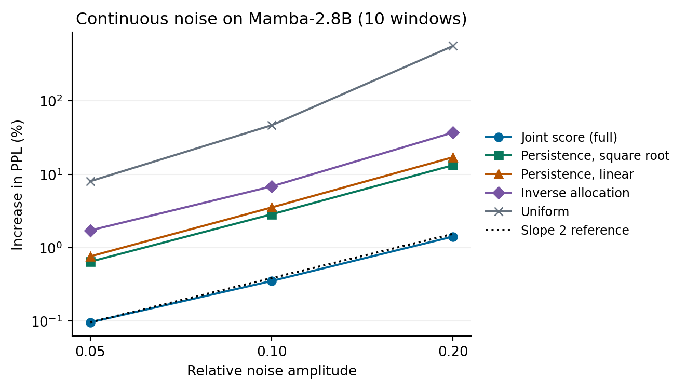
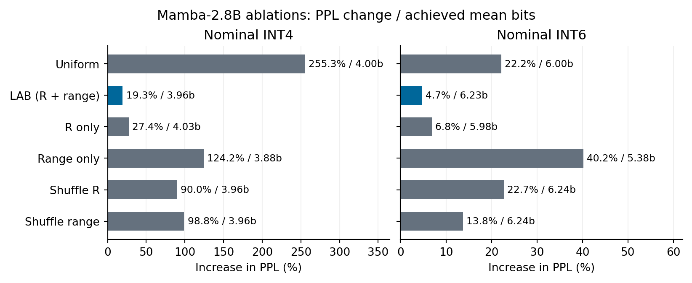
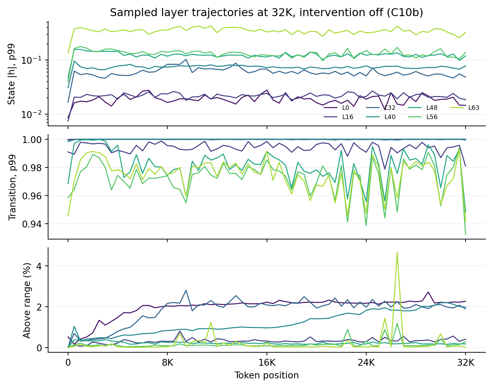

## Abstract

Quantisation errors in a recurrent state can affect later predictions. LAB assigns bits to state groups using three quantities measured during a short calibration pass: recurrence stability, output coupling, and state magnitude. Across five state-spaces Mamba models, the range-aware allocation at a nominal six bits yielded 2.44–2.65 times state-cache compression under an amortised metadata model, with perplexity increases of 3.35–3.98% on WikiText-2. At a nominal four bits the corresponding ranges were 3.52–3.96 times and 7.73–10.65%. The recommended allocation had the lowest perplexity increase among the five compared methods on seven models at both budgets; the eighth, Zamba2, was tested at six bits only, where another method was marginally better. An ablation on Mamba-2.8B showed that both the recurrence-based allocation score and the placement of the range correction contributed to performance. On two matched PG-19 windows, the recommended allocation outperformed uniform allocation at each of three context lengths. In a separate four-window comparison at 32K, clipping alone kept perplexity close to the quantised result. These measurements establish a quality–storage trade-off for the tested models; compression is calculated from the stored bit widths, while perplexity is measured with quantisation simulated in the forward pass.

## 1. Introduction

A transformer can compress a cached key or value once and read it many times. A Mamba layer instead updates a fixed-size state as it reads each token. Rounding a component changes the state carried into the next update. Two state groups with the same current magnitude may therefore warrant different bit widths. An error can persist longer in one group, or have a larger effect when the model reads it out.

LAB (Lyapunov-aware bit allocation) uses a short calibration sequence to estimate a group's persistence and its coupling to the output. Their combination gives an allocation score $R_g$. The state range $r_g$ determines the distance between quantisation levels at a given bit width. Accounting for both terms yields a different integer allocation from one based on $R_g$ alone. The question is whether this change buys better predictions at a useful storage budget.

Two rounds of integer experiments address different versions of this question. The initial transfer experiments used a slope-one, score-only rule. The reruns evaluated the range-aware rule while retaining the old rule as a comparison. For example, on Mamba-2.8B at nominal INT6, the earlier rule increased perplexity by 6.69%; the range-aware rule increased it by 3.98%. Throughout the integer results below, **LAB** denotes the latter. The archived Gaussian-noise and factorisation experiments answer separate questions about the score and its components (§§4.5, 6.2).

We distinguish three comparisons: quality across models at the same nominal budget (§5); quality versus achieved storage, including metadata (§6); and long-context perplexity with the methods evaluated on the same windows (§7). We use relative perplexity change, $100(\mathrm{PPL}/\mathrm{PPL}_{\rm FP16}-1)$, for the WikiText-2 experiments. Lower is better. The long-context tables report absolute perplexity.

## 2. Related Work

This section positions the present paper within four adjacent literatures: transformer KV-cache quantisation (which provides the analogue and the contrast for SSM state quantisation), SSM weight and activation quantisation (the most active body of recent work on Mamba compression), per-group and heterogeneous bit allocation in SSMs (the closest in spirit to our approach, but not driven by spectral-radius theory), and Lyapunov-related analyses of SSM dynamics (which are concerned with training stability rather than quantisation). We close with an explicit statement of the present work's position relative to all four.

### 2.1 Transformer KV-Cache Quantisation as Background

A line of recent work compresses the per-token key-value cache of transformer language models from 16 bits per element to 3 to 4 bits per element with negligible quality loss. KIVI [Liu et al., 2024] proposes per-channel quantisation for the key cache and per-token quantisation for the value cache, exploiting the asymmetry of their distributions. KVQuant [Hooper et al., 2024] extends sub-4-bit quantisation to longer contexts using a dense-and-sparse decomposition. Palu [Chang et al., 2024] caches low-rank projections of the key-value tensors. ZipCache [He et al., 2024] identifies salient tokens via normalised attention scores and compresses non-salient tokens more aggressively. These methods all exploit the per-token, per-element-independent structure of the transformer KV-cache: each cache slot is read once at attention time, the rounding errors do not feed back into a recurrence, and per-element noise variance translates directly into per-token attention error. None of these properties hold for the SSM hidden state, which is updated by an input-dependent linear recurrence (§3.1). The present paper inherits the transformer-side compression playbook in spirit, but the per-element optimisation argument that drives it must be rebuilt from first principles for the SSM substrate.

### 2.2 SSM Weight and Activation Quantisation

The first wave of post-training quantisation (PTQ) work on Mamba focused on weights and activations rather than the recurrent state. Mamba-PTQ [Pierro & Abreu, 2024] is among the earliest, identifying outlier channels in the recurrent LLM as the primary obstacle to naive transplants of transformer PTQ recipes. Quamba [Chiang et al., 2024] proposes a static 8-bit per-tensor quantisation scheme for the selective SSM, suppressing the maximum values of the input activations and quantising the output activations in an outlier-free space via a Hadamard transform; it reports a $1.72\times$ generation-latency reduction on Mamba-2.8B with $0.9 \,\%$ accuracy drop. MambaQuant [Xu et al., 2025] addresses outlier-driven accuracy loss with Karhunen-Loève transform-enhanced rotation and a smooth-fused rotation that equalises channel variances, achieving W8A8 with under $1 \,\%$ accuracy loss. OuroMamba [Ramachandran et al., 2025] presents a data-free PTQ for vision Mamba models, using channel-wise static weight quantisation and per-time-step dynamic activation quantisation. LightMamba [Wei et al., 2025] co-designs a 4-bit rotation-based PTQ with FPGA acceleration. Bi-Mamba [Tang et al., 2024] takes the alternative quantisation-aware-training (QAT) route to 1-bit weights, training Mamba models from scratch with autoregressive distillation. None of these methods quantise the recurrent state $h_t$ at per-(channel, state-unit) granularity with bit widths driven by spectral or output-coupling statistics, which is the focus of the present paper.

### 2.3 Per-Group and Heterogeneous Bit Allocation in SSMs

A smaller body of recent work allocates bits non-uniformly across SSM components, and is the closest in spirit to our approach. Quamba2 [Chiang et al., 2025] extends Quamba to W8A8, W4A8, and W4A16 across both Mamba-1 and Mamba-2 backbones, with per-state-group quantisation for the input-dependent parameters $B_t$ and $C_t$. Quamba2's groups are channel-wise (eight groups of 128 channels each), and within a group the quantisation is uniform 8-bit; cached SSM states are quantised at uniform 8-bit as well. The grouping is based on activation magnitude clustering and a Hadamard-style compute-invariance constraint, not on the recurrence's spectral radius or output coupling. Q-Mamba [Chen et al., 2025] proposes Decoupled Scale Quantisation (DSQ) for Mamba models, applying separate quantisation scales to outlier channels and inlier channels and quantising linear projections and state caches into low-bit integers; it reports memory and accuracy results on Mamba2-2.7B at W8A8H4. The recent edge-AI study of [Zhao et al., 2025] (Quantizing Small-Scale State-Space Models for Edge AI) reports a heterogeneous bit allocation in which the weight matrices $\bar B$, $\bar C$, $\bar D$ are quantised at 4 bits, activations other than the state at 6 bits, and the state $x$ and transition matrix $\bar A$ at 6 to 16 bits depending on ablation; their grouping is per-head (one group per parallel SSM head), their calibration uses a 99.999-percentile range estimate, and the bit allocation is determined by ablation rather than by a closed-form formula. SSDi8 [Kim et al., 2025] targets the Mamba-2 SSD computation specifically, designing an INT8 reformulation that decouples element-wise from matrix-wise multiplications and reuses quantised activations to maintain a persistent INT8 path through the SSD; it uses channel-aware quantisation and mean correction to keep accuracy. Q-S5 [Abreu et al., 2024] and QS4D [Siegel et al., 2025] explore quantisation of S5 and S4D structured SSMs respectively, primarily in the QAT regime. We narrow our novelty claim accordingly: per-state-group quantisation of SSM caches and heterogeneous bit allocation across SSM components have prior precedent in this literature; **to our knowledge, no prior work derives a variable-bit allocation rule for the recurrent hidden state $h_t$ as a closed-form function of the per-group spectral radius $\rho_g$ and output coupling $\Gamma_g$**, which is the contribution of the present paper.

### 2.4 State Clipping and Lyapunov-Style Analyses of SSM Dynamics

Two related lines of work touch on the long-context state-magnitude behaviour we discuss in §7.

The first is the small-scale state-clipping observation in [Zhao et al., 2025], who note that the recurrent state $x$ in S4D-class models can be constrained after each time step as a simple stabiliser for low-bit recurrent inference. They motivate this by the discrete-eigenvalue stability concern: if the quantised value of $\bar A$ falls outside the unit circle, the SSM recurrence is unstable, and clipping the state suppresses the resulting amplification. This idea is closely connected to the §7.3 / §7.4 finding of the present paper, where we observe on Mamba-2.8B-hf at PG-19 long context that calibrated state clipping at $r_g = k \cdot \mathrm{RMS}(h_g)$ stabilises the FP16 path that otherwise diverges. We extend the Zhao et al. observation from small-scale S4D to LLM-scale Mamba and from short to long-context inference, and we explicitly credit the underlying state-clipping idea to that earlier work.

The second is the Lyapunov-style training-stability analysis in [Halloran et al., 2024], who characterise the training-time stability of Mamba's selective recurrence using a Lyapunov function on the parameter trajectories. Their concern is whether Mamba's training is convergent rather than how to allocate quantisation noise across state groups; the present paper's use of a discrete-time Lyapunov bound on accumulated noise (§3.2) is methodologically related but addresses a different question.

Spectral State Space Models [Agarwal et al., 2023] proposes a new SSM family based on spectral filtering of linear dynamical systems; this is concerned with model design rather than compression and does not bear directly on the bit-allocation problem. To our knowledge no prior work translates a discrete-time Lyapunov bound on accumulated quantisation noise into a per-state-group bit-allocation rule for SSMs, which is the framing we develop in §3.

### 2.5 Position of the Present Work

LAB allocates bits *within* the recurrent state. The allocation score combines a persistence estimate with an output-coupling weight; the range correction then translates the continuous solution into integer widths. This differs from choosing channel groups by magnitude alone or quantising the input-dependent parameters while fixing the width of the state cache. State clipping has prior precedent in S4D [Zhao et al., 2025]. Its role here is an empirical comparison between clipping and quantisation on long-context Mamba inference.

## 3. Theory: A Lyapunov-Aware Bit Allocator

### 3.1 The State Recurrence and the Per-Step Quantisation Error

A discretised Mamba-class SSM updates its hidden state by

$$
h_t \;=\; \bar A_t\,h_{t-1} \;+\; \bar B_t\,x_t,
\qquad
y_t \;=\; C_t\,h_t \;+\; D\,x_t,
$$

where the per-step transition $\bar A_t$, input projection $\bar B_t$, and output projection $C_t$ are produced by input-dependent linear maps from $x_t$. For Mamba-1, the discretisation is $\bar A_t = \exp(dt_t \cdot A)$ with $A = -\exp(A_\mathrm{log})$ a per-state-unit negative real eigenvalue, and $\bar B_t = dt_t \cdot B_t$, where $dt_t \in \mathbb{R}_{>0}^{d_\mathrm{inner}}$ is the input-dependent time step. The hidden state $h_t \in \mathbb{R}^{d_\mathrm{inner} \times d_\mathrm{state}}$ is diagonal in the state-state direction, so each (channel $c$, state-unit $s$) is updated independently. Our analysis is per-(c, s); we use $g$ as a per-group index, with $g = (c, s)$ at the finest granularity.

Compare two paths through one layer with the same input sequence and initial state ($e_0=0$). The reference follows the recurrence above. On the quantised path, the previous state gives the candidate $u_t=\bar A_t\hat h_{t-1}+\bar B_t x_t$. The quantiser returns $\hat h_t=\mathcal Q(u_t)$ for the readout and the next update.

The local quantisation error is $\eta_t=\hat h_t-u_t$. The accumulated error is $e_t=\hat h_t-h_t$, the difference between the two paths at the same step. Adding and subtracting $u_t$ gives

$$
e_t = (u_t-h_t)+(\hat h_t-u_t) = \bar A_t e_{t-1}+\eta_t .
$$

The first term propagates earlier errors. The second accounts for rounding and any clipping at this step.

### 3.2 The Lyapunov Bound on Accumulated Noise

For one diagonal state group, suppose $|\bar A_t^{(g)}|\leq\rho_g<1$ and the injected noise has zero conditional mean, variance $\sigma_q^{(g)\,2}$, and is uncorrelated with the incoming state error after multiplication by the transition. Iterating the second-moment bound gives

$$
\mathbb{E}\bigl[(e_t^{(g)})^2\bigr]
\;\le\;
\frac{\sigma_q^{(g)\,2}}{1 - \rho_g^2}
\;\approx\;
\frac{\sigma_q^{(g)\,2}}{2\,(1 - \rho_g)}
\quad(\rho_g \to 1).
$$

The experiment uses the *empirical mean* transition magnitude as a persistence estimate. A mean is not a uniform bound on the transitions. The inequality motivates how we weight groups; it does not certify a variance bound for the measured model or an optimum for perplexity.

This is a discrete-time Lyapunov-type bound. The amplification factor $(1 - \rho_g)^{-1}$ has the same role as the convergence-rate factor in classical Lyapunov analysis of contraction maps: it characterises how rapidly the accumulated noise settles to its bounded equilibrium. As $\rho_g \to 1$, the per-step noise allowed for a target equilibrium error must scale as $\sqrt{1 - \rho_g}$, and the bit budget required to deliver such noise grows accordingly.

The empirical calibration also has a long-memory tail. On Mamba-2.8B-hf evaluated on 1024 tokens of WikiText-2 train, 18.6 % of the 5,242,880 per-(c, s) state units satisfy $\rho_g > 0.95$ and 3.2 % satisfy $\rho_g > 0.999$ (§4.1). For units above 0.999 the amplification factor is $10^3$ or larger, and a uniform per-element bit budget cannot deliver the per-step noise variance they require.

### 3.3 The Output Coupling and the Visible Error

The state error $e_t$ is not directly observable at the loss; it is mediated by the output projection $C_t$. Writing the readout per channel,

$$
y_t^{(c)} - \hat y_t^{(c)}
\;=\;
-\sum_s C_t^{(c, s)}\,e_t^{(c, s)}
\;=\;
-\sum_s C_t^{(s)}\,e_t^{(c, s)},
$$

In the noise model we neglect cross terms between groups and factor the expected squared error from the squared output coefficient. Under these approximations,

$$
\mathbb{E}\bigl[(y_t^{(c)} - \hat y_t^{(c)})^2\bigr]
\;=\;
\sum_s \mathbb{E}\bigl[(C_t^{(s)})^2\bigr] \cdot
       \mathbb{E}\bigl[(e_t^{(c, s)})^2\bigr]
\;=\;
\sum_s \Gamma_s \cdot
       \mathbb{E}\bigl[(e_t^{(c, s)})^2\bigr],
$$

with the per-state-unit output coupling magnitude $\Gamma_s = \mathbb{E}_t[(C_t^{(s)})^2]$. We use $\Gamma_g$ for the per-group quantity, where $\Gamma_g = \Gamma_s$ at our (c, s) granularity (the coupling is shared within a column).

Combining §3.2 and the present subsection, the per-(c, s) contribution to the visible mean-squared readout error is

$$
\Gamma_g \cdot \mathbb{E}\bigl[(e_t^{(g)})^2\bigr]
\;\propto\;
\frac{\Gamma_g \cdot \sigma_q^{(g)\,2}}{1 - \rho_g}
\;=\;
R_g \cdot \sigma_q^{(g)\,2},
\qquad
\boxed{R_g \;=\; \frac{\Gamma_g}{1 - \rho_g}}.
$$

### 3.4 The Bit-Budget-Optimal Allocation

The total visible mean-squared readout error under per-group i.i.d. quantisation noise is

$$
\mathrm{MSE}_\mathrm{total}
\;\propto\;
\sum_g R_g \cdot \sigma_q^{(g)\,2}.
$$

In the fine-resolution approximation, the error variance of a uniform quantiser is proportional to $r_g^2 4^{-b_g}$. This approximation neglects clipping and discrete rounding effects. We set $r_g=7\,\mathrm{RMS}(h_g)$ in the integer reruns. The initial score-only experiments also explored other range multipliers; the saved reruns do not establish which multiplier is best for LAB.

Minimising $\sum_g R_g \cdot r_g^2 \cdot 4^{-b_g}$ subject to a fixed total bit budget $\sum_g b_g = B_\mathrm{total}$ via Lagrange multiplier gives, at the unconstrained optimum,

$$
R_g \cdot r_g^2 \cdot 4^{-b_g} \;=\; \mathrm{const},
\qquad
b_g \;=\; \mathrm{const}' \;+\; \tfrac{1}{2} \log_2 R_g \;+\; \log_2 r_g.
$$

This optimum is continuous. The following experiments distinguish what can be tested about its shape under injected noise from what happens once the bit widths must be integers.

Restricted to the $R_g$-only formulation, the bit-budget-optimal noise allocation scales as

$$
\sigma_q^{(g)} \;\propto\; \frac{1}{\sqrt{R_g}}
\;=\;
\sqrt{\frac{1 - \rho_g}{\Gamma_g}}.
$$

### 3.5 The Integer Realisation of the $R_g$ Surface

The continuous optimum derived in §3.4 is $b_g \propto \tfrac{1}{2} \log_2 R_g + \log_2 r_g + \mathrm{const}$. For deployment-side bit budgeting we need an integer $b_g$ per group, fitting within a target average $b_0$ and bounded by a hardware-friendly minimum $b_\mathrm{min}$ to avoid sign-only quantisation. The strict continuous optimum of §3.4 is integerised directly:

$$
\mathrm{extras}_g \;=\; \bigl\lceil \tfrac{1}{2} \log_2 R_g \;+\; \log_2 r_g \;-\; \overline{\log_2 r_g} \bigr\rceil_+,
\qquad
b_g \;=\; \mathrm{round}\!\bigl(b_0 + \mathrm{extras}_g - \overline{\mathrm{extras}}\bigr)\Big|_{[b_\mathrm{min},\,16]},
$$

where $\overline{\log_2 r_g}$ denotes the global mean of $\log_2 r_g$ over all $(c, s)$ groups model-wide,
$$
\overline{\log_2 r_g} \;=\; \frac{1}{N_g}\sum_g \log_2 r_g,
$$
i.e., the mean of the log values, *not* the log of the mean ($\log_2 \overline{r_g}$). It centres the per-group $\log_2 r_g$ correction at zero so the correction term does not itself shift the mean bit width. Similarly, $\overline{\mathrm{extras}}$ is the global mean of the integer extras and the outer shift normalisation $- \overline{\mathrm{extras}}$ rebalances toward $b_0$. This construction tracks the §3.4 continuous optimum directly and is the rounded-and-clamped integer analogue of that optimum on the $R_g$ surface; we do not claim it solves the exact discrete integer programme after rounding, $b_\mathrm{min}$ floor, and $16$-bit ceiling.

The initial integer rule instead used $\lceil\log_2 R_g\rceil_+$ for the extra bits, with no range correction. In the seven rerun archives, the key for this initial rule is still usually `full`. The new rule in §3.5 is stored as `full_A` (C5b: `profile_full_A`; C9: `FP16_full_A`). We report measurements for these explicit keys rather than reading the legacy automated verdict on `full`. In the earlier, separately budget-matched C16 experiments the new rule was already present as `half_slope_rg`.

For the principal integer comparisons we use one mean shift followed by rounding and clamping to [2, 16]. The resulting mean can differ from the nominal budget. The factorisation experiment uses a binary search for the shift and reports the mean actually achieved.

### 3.6 Calibration

The two empirical inputs $\rho_g$ and $\Gamma_g$, together with the per-group state magnitude $\mathrm{RMS}(h_g)$ used for the range $r_g$, are calibrated from a single forward pass over a short calibration corpus. We use 1024 tokens of WikiText-2 train throughout this paper. The recipe is:

1. Run a forward-only inference pass that records, at every Mamba mixer, the per-(c, s) tensors $\bar A_t^{(c, s)}$, $C_t^{(s)}$, and the post-update state $h_t^{(c, s)}$.
2. Estimate $\rho_g$ as the empirical mean over $t$ of $|\bar A_t^{(c, s)}|$. The static-only estimate from $A_\mathrm{log}$ alone (with a fixed $dt = 0.1$) underestimates the long-memory tail by approximately fifty-fold on Mamba-2.8B-hf; the input-dependent estimate is the right input to the bit allocator (§4.1).
3. Estimate $\Gamma_g$ as the empirical mean over $t$ of $(C_t^{(s)})^2$.
4. Estimate $\mathrm{RMS}(h_g)$ as $\sqrt{\mathbb{E}_t[(h_t^{(c, s)})^2]}$ via streaming accumulation over the calibration window.

The total cost is one forward pass over 1024 tokens plus per-mixer streaming statistics in float32. For Mamba-2.8B-hf this amounts to roughly 30 seconds of GPU time and about 5 GB of activation memory; the resulting per-(c, s) statistics are stored once and reused for all subsequent allocator and range computations. No gradient propagation, no quantisation-aware fine-tuning, and no per-deployment retraining is involved.

Train- versus validation-split stability was measured in the first round (§4.3). The correlation for log output coupling was 0.987. The recorded 77.5% agreement in integer tiers belongs to the initial score-only rule; no corresponding agreement rate was measured for the range-aware rule.

## 4. Single-Architecture Validation: Mamba-2.8B-hf

We use Mamba-2.8B-hf to separate three kinds of evidence: first-round calibration statistics; a continuous-noise experiment in which no integers are assigned; and the integer rerun at fixed range multiplier $k=7$.

### 4.1 The Empirical Spectral-Radius Distribution

The first calibration step measures the per-(c, s) spectral radius $\rho_g$ of the discretised Mamba-1 transition $\bar A_t = \exp(dt_t A)$ with $A = -\exp(A_\mathrm{log})$. Two estimators are available: a static-only estimator that uses $A_\mathrm{log}$ alone with a fixed $dt = 0.1$ (the convention used in many static analyses of SSMs), and an empirical estimator that captures the actual input-dependent $dt$ under WikiText-2 input. We compare both. The two estimators are similar at the population median ($\rho_g$ p50 $\approx 0.6$) but diverge sharply in the long-memory tail.

| $\rho_g$ band | static, $dt = 0.1$ | empirical, input-dependent $dt$ | shift |
|:---:|---:|---:|:---:|
| $[0.95, 0.99)$ | $0.42 \,\%$ (21,919 units) | $9.7 \,\%$ (508,316 units) | 23× |
| $[0.99, 0.999)$ | $0.000229 \,\%$ (12 units) | $5.7 \,\%$ (299,183 units) | $24\,932\times$ |
| $[0.999, 1.000]$ | $0$ | $3.2 \,\%$ (165,816 units) | $0 \to 165{,}816$ |

The empirical long-memory tail ($\rho_g > 0.95$) covers $18.6 \,\%$ of the 5,242,880 per-(c, s) state units in Mamba-2.8B-hf, fifty times larger than the $0.4 \,\%$ the static estimator predicts. The very-long-memory tail ($\rho_g > 0.999$) goes from zero units in the static estimate to 165,816 units in the empirical estimate. The gap arises because per-layer median $dt$ observed empirically is in the $0.017$ to $0.125$ range, often well below the static assumption of $0.1$; the contraction factor $\exp(-dt \cdot |A|)$ is then much closer to one.

The empirical $\rho_g$ distribution also exhibits strong per-layer heterogeneity. Median $\rho_g$ across the 64 layers traces a U-shape: short-memory layers at the input end ($\rho_g$ p50 $\approx 0.60$ at layer 0), a long-memory core in the middle ($\rho_g$ p50 $\approx 0.88$ at layers 32 and 40), and short-memory layers again at the output end ($\rho_g$ p50 $\approx 0.39$ at layer 56). These layer differences enter the allocation through the calibrated group statistics. The shift in §3.5 is shared across layers.

The conclusion of §4.1 is that the empirical, input-dependent $\rho_g$ is the right input to the bit allocator, and that the long-memory minority is sufficiently large (in the hundreds of thousands of state units, not a handful) that protecting it with extra bits is the central design challenge. Figure 1(a) summarises the empirical $\rho_g$ distribution; Figure 1(b) anticipates the output-coupling heterogeneity discussed next.

![Why a uniform bit budget is the wrong default for SSM state quantisation, on Mamba-2.8B-hf calibrated from 1024 tokens of WikiText-2 train. **(a)** Empirical $\rho_g$ distribution across all 5,242,880 per-$(c, s)$ state units, in six $\rho_g$ buckets. The two right-most buckets contain the long-memory tail ($\rho_g \geq 0.99$, $8.87 \,\%$ of state units) where the $(1 - \rho_g)^{-1}$ amplification factor is at least two orders of magnitude. **(b)** Per-layer output-coupling heterogeneity: each bar is the within-layer $\Gamma_\mathrm{max} / \Gamma_\mathrm{min}$ ratio for one of the 64 Mamba mixers, sorted by ratio. The ratio ranges from $31\times$ at the lowest-spread layer to $9{,}144\times$ at the highest-spread layer, with median $452\times$. The combined per-$(c, s)$ surface $R_g = \Gamma_g / (1 - \rho_g)$ inherits both heavy tails and motivates the per-$(c, s)$ variable bit width of §3.](figures/fig01_R_distribution.png){#fig:R_distribution width=100%}

### 4.2 Output-Coupling Extraction and the $R_g$ Surface

The output-coupling extraction measures the per-state-unit $\Gamma_s = \mathbb{E}_t[(C_t^{(s)})^2]$ by replaying the Mamba-1 forward path under WikiText-2 input and intercepting the output of `mix.x_proj`, which produces $dt_\mathrm{raw}$, $B_t$, and $C_t$ as concatenated $[d_{t,\mathrm{rank}}, d_\mathrm{state}, d_\mathrm{state}]$ slices. The third slice is averaged in squared form per state-unit $s$ over the 1024-token calibration window. In Mamba-1, $C_t$ is shared across channels for each $s$, so $\Gamma_g = \Gamma_s$ at our (c, s) granularity, and the model has only $64 \times 16 = 1024$ distinct $\Gamma$ scalars in total.

The per-layer $\Gamma_s$ distribution is heavy-tailed. The within-layer $\Gamma_\mathrm{max} / \Gamma_\mathrm{min}$ ratio across the 16 state indices ranges from $31\times$ at the lowest-spread layer to $9{,}144\times$ at the highest-spread layer (median $452\times$); examples include $167\times$ at layer 32 and $1{,}572\times$ at layer 56. The per-layer $\Gamma_\mathrm{max}$ grows toward the output end (e.g., $\Gamma_\mathrm{max} = 5.1$ at layer 0, $27.1$ at layer 48, $45.4$ at layer 56). A small handful of state indices contribute the largest readout magnitudes in the late stages of the model, with the remaining state indices contributing more weakly to the per-channel output sum. We are careful not to label the smaller-$\Gamma$ state indices as functionally inactive: their per-step contribution to the readout is small in magnitude, but they may still carry context-dependent information that is exploited non-linearly downstream. A direct functional ablation of small-$\Gamma$ state indices is left as a candidate refinement.

The initial calibration gave a global log–log Pearson correlation of 0.635 between the persistence-only score and the joint score. The two scores can assign quite different priorities even when they use the same persistence estimates. This is evidence about the score, before applying the rerun's range correction.

### 4.3 Calibration Robustness

A critical question for the deployment claim is whether the calibration is sensitive to the choice of corpus. We re-run the $\Gamma_s$, $\rho_g$, and $\mathrm{RMS}(h_g)$ extraction on WikiText-2 validation (instead of train) and compare the resulting per-(c, s) statistics. Pre-registered acceptance thresholds were $\mathrm{Pearson}(\log \Gamma_g) \ge 0.95$ and bit-tier match $\ge 80 \,\%$.

| quantity | global $\mathrm{Pearson}(\log \cdot)$ | reading |
|:---|---:|:---|
| $\rho_g$ (5.24 M units) | $0.9954$ | essentially text-independent (its near-static parameter origin) |
| $\Gamma_s$ (1024 scalars) | $0.9870$ | above the $0.95$ threshold globally |
| $\mathrm{RMS}(h_g)$ (5.24 M units) | $0.9581$ | borderline; expected since $h$ integrates input |

Per-layer $\mathrm{Pearson}(\log \Gamma_s)$ is concentrated in $0.92$ to $1.00$ across 62 layers, with a single sharp outlier at layer 30 ($\mathrm{Pearson} = 0.57$). Layer 30 sits just below the long-memory core (layers 32 to 40) and has only 16 $\Gamma_s$ values per layer, so a one- or two-entry shift on its outlier dimensions disproportionately drags the per-layer correlation. Globally aggregated to all 1024 $(\mathrm{layer}, s)$ pairs the effect dissolves.

On the initial, score-only rule, 77.54% of state units had the same extra-bit tier under both calibrations. This missed the prespecified 80% threshold, although most differences were one bit. The archived test used $\lceil\log_2 R_g\rceil_+$; it did not compare the train and validation allocations from §3.5. Stability under the range-aware rule and across corpora remains open.

### 4.4 Sensitivity to Gaussian noise in the recurrent state

To test whether the score identifies sensitive groups, we added a fresh Gaussian perturbation to each group after the state update. The perturbed state supplied both the current readout and the next update. In this continuous-noise experiment, let $a_g$ denote a profile's shape in the table below. We set the noise standard deviation in group $g$ to

$$
\sigma_g = \alpha\,\mathrm{RMS}(h_g)\,
           \frac{a_g}{\sqrt{\langle a^2\rangle_g}} .
$$

The denominator is the RMS of the shape across all state units and layers. With $\alpha=0.10$, uniform noise has a standard deviation of 10% of each group's calibrated state RMS. Each alternative profile has the same RMS relative intensity across units, with more noise in some groups and less in others. The joint profile (`full`) uses $a_g=R_g^{-1/2}$.

| profile | Relative noise shape $a_g$ | $\Delta\mathrm{PPL}$ vs FP16 |
|:---|:---|---:|
| **full** (continuous) | $\sqrt{(1 - \rho_g)/\Gamma_g}$ | $\mathbf{+0.351 \,\%}$ |
| Proxy (sqrt) | $\sqrt{1 - \rho_g}$ | $+2.850 \,\%$ |
| Proxy (linear) | $1 - \rho_g$ | $+3.531 \,\%$ |
| Anti | $\sqrt{\Gamma_g / (1 - \rho_g)}$ | $+6.839 \,\%$ |
| **uniform** | constant | $\mathbf{+46.624 \,\%}$ |

Here and below, the two proxy names refer to the archived keys `proxy_correct` and `proxy_C2`; the opposite allocation is `anti_full`. The joint profile produced the smallest increase (0.351%); the persistence-only controls were next. The ordering in this table concerns direct perturbations of the state. An earlier surrogate experiment perturbed the model parameter $A_{\log}$ instead. The surrogate and direct perturbation results are not pooled.

### 4.5 Response to the amplitude of continuous noise

Across the three noise amplitudes, we computed the exponent for each adjacent doubling as $\log_2(\Delta\mathrm{PPL}_{2s}/\Delta\mathrm{PPL}_{s})$. The last column gives their midpoint and half their separation. The first three numerical columns are ΔPPL (%) at relative amplitudes 0.05, 0.10 and 0.20. The next two give consecutive doubling ratios. The exponent is descriptive, not a confidence interval.

| Profile | 0.05 | 0.10 | 0.20 | First ratio | Second ratio | Exponent |
|:---|---:|---:|---:|---:|---:|:---:|
| **full** | $\mathbf{+0.096 \,\%}$ | $\mathbf{+0.351 \,\%}$ | $\mathbf{+1.415 \,\%}$ | $3.66\times$ | $4.03\times$ | $1.94 \pm 0.07$ |
| Proxy (sqrt) | $+0.643 \,\%$ | $+2.850 \,\%$ | $+13.284 \,\%$ | $4.43\times$ | $4.66\times$ | $2.18 \pm 0.04$ |
| Proxy (linear) | $+0.760 \,\%$ | $+3.531 \,\%$ | $+17.094 \,\%$ | $4.65\times$ | $4.84\times$ | $2.25 \pm 0.03$ |
| Anti | $+1.718 \,\%$ | $+6.839 \,\%$ | $+37.112 \,\%$ | $3.98\times$ | $5.43\times$ | $2.22 \pm 0.22$ |
| **uniform** | $+8.039 \,\%$ | $+46.624 \,\%$ | $+561.134 \,\%$ | $5.80\times$ | $12.04\times$ | $3.06 \pm 0.53$ |

For the joint profile, doubling the noise multiplied the relative PPL increase by 3.66 and 4.03. The two exponents were 1.871 and 2.009, giving $1.94\pm0.07$. This profile was closest to quadratic scaling and had the lowest PPL increase at all three amplitudes. The complete ordering of the five profiles in this experiment is specific to the continuous-noise channel.

### 4.6 Integer allocation at fixed range

On Mamba-2.8B, LAB uses the group widths $b_g$ from §3.5. All five methods apply the same quantiser once the widths are set. Write $m_g=2^{b_g-1}$ and let $r_g=k\,\mathrm{RMS}(h_g)$ be the calibrated range. For a post-update value $u_t^{(g)}$, the patched forward pass uses the grid spacing $\Delta_g=\max(r_g/m_g,10^{-6})$ and computes

$$
q_g=\mathrm{clip}\!\left(\mathrm{round}(u_t^{(g)}/\Delta_g),-m_g,m_g-1\right),
\qquad \hat h_t^{(g)}=\Delta_g q_g .
$$

Rounding selects the nearest integer (ties to even), and clipping keeps the code within the signed $b_g$-bit range, which includes zero. The forward pass reads out the dequantised FP32 value and carries it into the next token update. Section 5.2 describes the chunk-boundary variant for Zamba2.

The original C4 sweep reported 15 wins for the *initial* integer rule over five budgets and three range multipliers. The saved rerun evaluates LAB at $k=7$ over all five budgets on the same ten windows. Entries are relative PPL increases, and the ratio divides the uniform increase by the LAB increase.

| profile | INT3 | INT4 | INT5 | INT6 | INT8 |
|:---|---:|---:|---:|---:|---:|
| **LAB** | $\mathbf{+25.19 \,\%}$ | $\mathbf{+10.17 \,\%}$ | $\mathbf{+5.32 \,\%}$ | $\mathbf{+3.98 \,\%}$ | $\mathbf{+3.52 \,\%}$ |
| Proxy (sqrt) | $+854.0 \,\%$ | $+73.78 \,\%$ | $+18.40 \,\%$ | $+8.32 \,\%$ | $+3.80 \,\%$ |
| Proxy (linear) | $+721.8 \,\%$ | $+301.8 \,\%$ | $+167.1 \,\%$ | $+31.31 \,\%$ | $+5.63 \,\%$ |
| **uniform** | $\mathbf{+1582 \,\%}$ | $\mathbf{+221.3 \,\%}$ | $\mathbf{+51.89 \,\%}$ | $\mathbf{+18.68 \,\%}$ | $\mathbf{+6.28 \,\%}$ |
| Anti | $+2567 \,\%$ | $+1440 \,\%$ | $+449.4 \,\%$ | $+164.6 \,\%$ | $+89.68 \,\%$ |
| uniform / LAB | $62.8\times$ | $21.8\times$ | $9.74\times$ | $4.69\times$ | $1.78\times$ |

LAB had the smallest ΔPPL at all five recorded budgets (5/5); the new rule was not evaluated at $k=3$ or $k=5$ in the saved rerun. The old `full` row at INT6 is +6.69%, alongside the LAB row at +3.98%. Legacy success flags in this file still evaluate the old row.

At the tested budgets, the first LAB configuration below a 10% PPL increase was INT5, versus INT8 for uniform (INT7 was not tested). LAB's PPL penalty decreased by factors of 0.40 and 0.52 between INT3 and INT5. These are improvements, but they differ from the ideal factor of 0.25 per bit for squared quantisation error. The integer results do not establish the same scaling law as the continuous-noise results.

## 5. Transfer of the integer allocation across models

We compare LAB with four prespecified approaches to assigning integer widths: uniform allocation, two persistence-only proxies (`proxy_correct` and `proxy_C2`), and allocation in the opposite direction (`anti_full`). The literal `full` row retained in the rerun files is the legacy integer method and is outside this five-method comparison. For all rerun comparisons below, the range multiplier is seven, the minimum is two bits, and PPL is evaluated on WikiText-2 test at context length 1024.

### 5.1 Five sizes of state-spaces Mamba-1

At each size, INT4 and INT6 specify the *nominal* mean bit budget. The table compares percentage increases in PPL; ratios divide the uniform increase by the LAB increase. The four smaller models come from the C8a rerun. The “Initial (6)” column gives the original score-only INT6 ΔPPL for comparison. LAB columns come from the range-aware reruns. For 2.8B we use the original-precision C4 rerun measurements: the row in the C8a summary is a rounded copy, not an independent replication.

| size | FP16 PPL | Initial (6) | LAB (4) | Ratio (4) | LAB (6) | Ratio (6) |
|:---:|---:|---:|---:|:---:|---:|:---:|
| 130M | 25.13 | +6.89% | $+8.2 \,\%$ | $17.0\times$ | $+3.4 \,\%$ | $6.9\times$ |
| 370M | 18.58 | +3.95% | $+9.5 \,\%$ | $12.6\times$ | $+3.8 \,\%$ | $5.2\times$ |
| 790M | 15.42 | +4.55% | $+7.7 \,\%$ | $18.9\times$ | $+3.6 \,\%$ | $5.2\times$ |
| 1.4B | 14.30 | +7.98% | $+10.6 \,\%$ | $12.0\times$ | $+3.7 \,\%$ | $4.9\times$ |
| 2.8B (anchor) | 12.37 | +6.69% | $+10.2 \,\%$ | $21.8\times$ | $+4.0 \,\%$ | $4.7\times$ |

LAB had the lowest ΔPPL of the five methods in all ten model–budget combinations. Its INT6 penalty varied from +3.35% to +3.98%, whereas uniform allocation cost +18.18% to +23.09%. Section 6 reports the achieved bit widths behind this comparison; nominally equal budgets do not imply exactly equal storage.

### 5.2 Architectural Transfer: Mamba-2 SSD via Zyphra Zamba2-1.2B

We test the bit allocator on the Mamba-2 (SSD) branch of the architecture. Mamba-2's selective scan replaces Mamba-1's per-channel parallel SSM with a chunked SSD computation in which the per-(head, state) state is materialised only at chunk boundaries, and within a chunk the recurrence is folded into matrix multiplications. Two changes are required in our protocol. First, the bit-allocation granularity adapts from per-(channel, state) to per-(head, state), since Mamba-2 has scalar $A_\mathrm{log}$ per head (not per channel). Second, the quantisation injection point shifts from per-token (the position in §4.4) to per-chunk-boundary (the only point at which the state tensor is materialised in the SSD path).

We tested two implementations: a hand-written per-token loop that reproduced the Mamba-2 update step, and a chunk-boundary quantisation that keeps the SSD math bit-for-bit and injects the quantiser only on the inter-chunk states tensor that SSD already computes. The per-token loop drifted by $-3 \,\%$ from the SSD reference on FP16 PPL (a subtle math mismatch we could not pin down quickly), so the chunk-boundary form was adopted. Its mode='off' shortcuts to the original `torch_forward`, so the FP16 baseline is guaranteed identical.

For Zamba2, a hybrid with Mamba-2 SSD blocks, bit widths are shared over the head dimension and quantisation is applied at chunk boundaries. The C5b rerun provides one budget, INT6, with five evaluation windows. The range-aware result is the row named `profile_full_A`.

| profile | ΔPPL |
|:---|---:|
| Proxy (linear) | $-0.720 \,\%$ |
| **LAB** | $\mathbf{-0.692 \,\%}$ |
| Proxy (sqrt) | $-0.658 \,\%$ |
| uniform | $-0.462 \,\%$ |
| Anti | $+7.065 \,\%$ |

Here LAB was second among the five methods: proxy_C2 had a lower ΔPPL by 0.028 percentage points. The three allocation profiles span only 0.062 percentage points, and all three improve on uniform allocation in these windows. This is a small descriptive difference on a different injection schedule, not evidence that LAB ranks first on Zamba2.

### 5.3 Cross-Lineage Transfer: TII Falcon-Mamba-7B

We test the bit allocator on Falcon-Mamba-7B (`tiiuae/falcon-mamba-7b`), the largest open-weight Mamba-1 model and the only one not from the state-spaces release line. Falcon-Mamba was trained on RefinedWeb at 7B scale and uses a different forward-path convention: weightless `rms_forward` (RMSNorm without learnable weight) is applied to $B_t$, $C_t$, and $dt_\mathrm{raw}$ before the discretisation. The patched forward of §4.4 detects this via the `mix.rms_eps` attribute and applies the same normalisation before computing $\bar A_t$, $\bar B_t$, and $C_t$.

| profile | $b_0 = 4$ | $b_0 = 6$ |
|:---|---:|---:|
| **LAB** | $\mathbf{+57.9 \,\%}$ | $\mathbf{+27.9 \,\%}$ |
| Proxy (sqrt) | $+91.9 \,\%$ | $+35.5 \,\%$ |
| uniform | $+111.9 \,\%$ | $+54.6 \,\%$ |
| Proxy (linear) | $+128.1 \,\%$ | $+58.7 \,\%$ |
| Anti | $+271.4 \,\%$ | $+193.2 \,\%$ |

On ten windows at each budget, LAB had the smallest PPL increase. The uniform-to-LAB ΔPPL ratio was 1.93 at INT4 and 1.96 at INT6. The absolute penalties on Falcon were much larger than those on state-spaces Mamba. Uniform also outperformed proxy_C2 here, a direct counterexample to a universal ordering of the controls.

### 5.4 Hybrid Architecture + MoE: AI21 Jamba-1.5-Mini

The widest stretch of the generalisation chain is Jamba-1.5-Mini (`ai21labs/AI21-Jamba-Mini-1.6`), a 52B-total / 12B-active hybrid model from a third release lineage. Jamba interleaves Mamba-1 mixers with transformer attention and MoE expert layers, and uses learnable RMSNorm modules (`mix.dt_layernorm`, `mix.b_layernorm`, `mix.c_layernorm`) instead of Falcon's weightless `rms_forward` to normalise $dt_\mathrm{raw}$, $B_t$, and $C_t$ before discretisation. The patched forward grew a third lineage branch detected via the `mix.dt_layernorm` attribute. Loaded in FP16 with `device_map="auto"` on a 102 GB GPU runtime, with mild CPU offload (about 84 GB VRAM resident); 28 Mamba-1 mixers were detected, interleaved with the attention and MoE layers (which were held at FP16 throughout, since the present paper does not quantise attention).

| profile | $b_0 = 4$ | $b_0 = 6$ |
|:---|---:|---:|
| **LAB** | $\mathbf{+8.9 \,\%}$ | $\mathbf{+1.5 \,\%}$ |
| Proxy (sqrt) | $+49.2 \,\%$ | $+5.4 \,\%$ |
| uniform | $+41.8 \,\%$ | $+14.4 \,\%$ |
| Proxy (linear) | $+97.6 \,\%$ | $+12.4 \,\%$ |
| Anti | $+104.2 \,\%$ | $+88.7 \,\%$ |

LAB ranked first at both budgets on five windows. Uniform ΔPPL was 4.70 times the LAB penalty at INT4 and 9.35 times at INT6. The small INT6 penalty on this hybrid is consistent with a useful range correction, but the comparison with persistence-only proxies changes more than one term. The relative contributions of coupling and range on Jamba were not isolated.

### 5.5 What transfers

Across the five state-spaces sizes, Falcon, and Jamba, LAB ranked first at **both** tested budgets. Zamba2 contributed one INT6 condition and ranked LAB second. This gives **14 first places in 15 evaluated model–budget cells**, with seven of eight models first at both budgets. The full ordering seen in the continuous-noise experiment (§4.4) occurred in **none of the 15** integer cells. What transfers is LAB's advantage over uniform and its frequent first place among the five methods, not a fixed ordering of all four controls. The magnitude of the advantage remains model dependent.

## 6. Packed-State Memory Accounting Paired with Fake-Quant Perplexity

Perplexity and compression answer different questions. PPL was measured by quantising and dequantising inside the forward path. Storage is calculated from the actual bit widths in the saved rows, assuming a packed layout. No latency, bandwidth, kernel execution speed, or end-to-end device-memory saving was measured.

### 6.1 Storage model

With mean width $\bar b$, the state values alone give an estimated compression of $16/\bar b$ relative to FP16. Each group also needs a 16-bit range and a 4-bit width. If $N$ separately stored states share that metadata, its cost per group per state is $20/N$ bits. The metadata-inclusive compression is therefore $16/(\bar b+20/N)$.

For both INT4 and INT6 we use $N=100$, as in a cache that retains 100 chunk-boundary states with the same calibration. This gives the $0.2$-bit overhead used in the tables. A single sequence that overwrites its only state at every token has $N=1$ under the same accounting, however many tokens it processes.

### 6.2 Lyapunov-vs-Range Factorisation on Mamba-2.8B-hf

The §3.5 integer construction combines three signals: the recurrence-stability factor $(1 - \rho_g)^{-1}$, the output-coupling weight $\Gamma_g$, and the per-group range $r_g$. We have seen in §5.1 that this construction wins against `uniform` at every $(model, b_0)$ cell of the state-spaces Mamba-1 family. This section asks the harder follow-up question on Mamba-2.8B-hf: is the joint $R_g = \Gamma_g / (1 - \rho_g)$ surface doing structural work, or could range-aware allocation alone (bits placed by per-group state magnitude) reproduce the recipe's advantage?

In the earlier C16 and C16b experiments, the same range-aware extra-bit formula was already present under the name `half_slope_rg`. The comparison used five evaluation windows and binary search for a shift that brought the post-clamp mean near the target. In the C4 anchor rerun, the shift was applied once and ten windows were scored. Thus the factorisation and deployment tables share a recipe but estimate its performance under different conditions. In particular, the achieved mean for `range_only` at nominal INT6 misses the target by 0.62 bits.

- `half_slope`: $\mathrm{extras}_g = \lceil \tfrac{1}{2} \log_2 R_g \rceil_+$. The integer construction stripped of the $\log_2 r_g$ term, retained for the $R_g$-vs-$r_g$ factorisation comparison below.
- `range_only`: $\mathrm{extras}_g = \lceil \log_2 r_g - \overline{\log_2 r_g} \rceil_+$. Bits go to high-magnitude groups only, with no $R_g$ signal at all.
- `shuffled_R_plus_r`: shuffle the $\log_2 R_g$ values across all $(c, s)$ groups model-wide before adding $\log_2 r_g - \overline{\log_2 r_g}$ and rounding. Preserves the per-group $r_g$ placement and the global distribution of $\log_2 R_g$, but randomises which $(c, s)$ unit gets which $\log_2 R_g$ value.
- `R_plus_shuffled_r`: shuffle the $\log_2 r_g$ values across all $(c, s)$ groups model-wide before adding to $0.5 \cdot \log_2 R_g$ and rounding. Preserves the per-group $R_g$ placement and the global distribution of $\log_2 r_g$, but randomises which $(c, s)$ unit gets which $\log_2 r_g$ value.

The two shuffles permute the assignments of the score or the range across units. We take the reference, uniform, and R-only rows from C16 and the three factorisation rows from C16b. Overlapping reference rows agree in PPL and achieved mean. The following table reports ΔPPL, with achieved mean bits in parentheses; all six profiles use the same five-window evaluation on Mamba-2.8B.

| profile | $b_0 = 4$ | $b_0 = 6$ |
|:---|:---|:---|
| `uniform` (no signal) | $+255.3 \,\%$ ($4.00$) | $+22.2 \,\%$ ($6.00$) |
| **LAB (R + r)** | $\mathbf{+19.3 \,\%}$ ($\mathbf{3.96}$) | $\mathbf{+4.7 \,\%}$ ($\mathbf{6.23}$) |
| `half_slope` (R-only, no r) | $+27.4 \,\%$ ($4.03$) | $+6.8 \,\%$ ($5.98$) |
| `range_only` (r-only, no R) | $+124.2 \,\%$ ($3.88$) | $+40.2 \,\%$ ($5.38$) |
| `shuffled_R_plus_r` (R-shuffled + r) | $+90.0 \,\%$ ($3.96$) | $+22.7 \,\%$ ($6.24$) |
| `R_plus_shuffled_r` (R + r-shuffled) | $+98.8 \,\%$ ($3.96$) | $+13.8 \,\%$ ($6.24$) |

At INT4, the reference cost 19.3% at 3.96 bits; R-only cost 27.4% at 4.03 bits and range-only cost 124.2% at 3.88 bits. The R score carried information that a range-only allocation could not recover on these windows. Either shuffle also increased the penalty despite similar achieved widths. At INT6 the two shuffles (6.24 bits) are the cleaner comparisons to the 6.23-bit reference: the 5.38-bit range-only result combines a change in allocation with less storage. The +10.17% LAB penalty at INT4 in §4.6 is a different measurement, at 4.35 achieved bits on ten windows. The difference cannot be assigned to the choice of shift alone.

### 6.3 The Deployment Table at $b_0 = 6$

The deployment table uses the one-pass-shift integer reruns. We use the saved PPL and mean bits for each profile and compute both storage ratios directly from the unrounded mean. The initial C6 packing summary contains the slope-one allocator rather than the range-aware LAB entries in this table.

| Model | profile | $\overline{b_g}$ | payload only | incl. metadata | ΔPPL |
|:---|:---|:---:|:---:|:---:|---:|
| Mamba-130M | uniform | $6.00$ | $2.67\times$ | $2.58\times$ | $+23.09 \,\%$ |
| | Proxy (sqrt) | $6.00$ | $2.66\times$ | $2.58\times$ | $+13.77 \,\%$ |
| | **LAB** | $\mathbf{5.91}$ | $\mathbf{2.71\times}$ | $\mathbf{2.62\times}$ | $\mathbf{+3.35 \,\%}$ |
| Mamba-370M | uniform | $6.00$ | $2.67\times$ | $2.58\times$ | $+19.96 \,\%$ |
| | Proxy (sqrt) | $6.00$ | $2.67\times$ | $2.58\times$ | $+13.20 \,\%$ |
| | **LAB** | $\mathbf{5.84}$ | $\mathbf{2.74\times}$ | $\mathbf{2.65\times}$ | $\mathbf{+3.84 \,\%}$ |
| Mamba-790M | uniform | $6.00$ | $2.67\times$ | $2.58\times$ | $+18.91 \,\%$ |
| | Proxy (sqrt) | $6.03$ | $2.65\times$ | $2.57\times$ | $+10.64 \,\%$ |
| | **LAB** | $\mathbf{6.16}$ | $\mathbf{2.60\times}$ | $\mathbf{2.52\times}$ | $\mathbf{+3.62 \,\%}$ |
| Mamba-1.4B | uniform | $6.00$ | $2.67\times$ | $2.58\times$ | $+18.18 \,\%$ |
| | Proxy (sqrt) | $6.11$ | $2.62\times$ | $2.53\times$ | $+8.44 \,\%$ |
| | **LAB** | $\mathbf{6.27}$ | $\mathbf{2.55\times}$ | $\mathbf{2.47\times}$ | $\mathbf{+3.68 \,\%}$ |
| Mamba-2.8B | uniform | $6.00$ | $2.67\times$ | $2.58\times$ | $+18.68 \,\%$ |
| | Proxy (sqrt) | $6.10$ | $2.62\times$ | $2.54\times$ | $+8.32 \,\%$ |
| | **LAB** | $\mathbf{6.35}$ | $\mathbf{2.52\times}$ | $\mathbf{2.44\times}$ | $\mathbf{+3.98 \,\%}$ |

Across these five sizes, the LAB penalty is 3.35–3.98%, with metadata-inclusive compression of 2.44–2.65 times. This is a state-cache estimate, not a reduction of all model memory.

### 6.4 The trade-off at the two common budgets

For each model we pool the five methods at the two budgets available for *all* sizes (ten points per model). A point is dominated if another has no greater achieved mean width and no greater ΔPPL, with at least one strict improvement. Because all rows use the same metadata convention, minimising achieved width also maximises estimated compression.

In order of model size, **2, 2, 4, 6, and 6** points are non-dominated. Both LAB budgets lie on the frontier for every model. Uniform INT4 is on the frontier for three of the five models (790M, 1.4B, and 2.8B). A LAB point need not dominate uniform at the *same* nominal budget to be efficient in the pooled comparison. For example, on 790M, LAB at nominal INT4 uses fewer bits and incurs a smaller PPL penalty than uniform at INT6. If the 2.8B-only INT3, INT5, and INT8 settings are added, its frontier has nine points and uniform INT4 drops out. The historical C6 frontier concerns the earlier allocation.

### 6.5 Achieved versus nominal width

At nominal INT6 the achieved LAB means range from 5.84 to 6.35 bits. The one-pass shift and rounding can undershoot or overshoot: the smaller two models used less storage than uniform, while the other three used more. Both ΔPPL and achieved width are therefore necessary for interpreting a ranking at fixed nominal budget. The targeted-mean comparison in §6.2 is separate.

### 6.6 Aggressive four-bit budgets

The INT4 table uses exactly the same two storage definitions as §6.3. Both columns are ratios to FP16; the final column gives the measured relative PPL increase.

| Size | Mean bits | Payload only | Incl. metadata | ΔPPL |
| :--- | ---: | ---: | ---: | ---: |
| 130M | 3.91 | 4.09× | 3.89× | +8.17% |
| 370M | 3.84 | 4.17× | 3.96× | +9.54% |
| 790M | 4.16 | 3.85× | 3.67× | +7.73% |
| 1.4B | 4.27 | 3.75× | 3.58× | +10.65% |
| 2.8B | 4.35 | 3.68× | 3.52× | +10.17% |

Metadata-inclusive compression is 3.52–3.96 times at nominal INT4; the corresponding payload-only range is 3.68–4.17 times. All five models remained below an 11% PPL penalty on the recorded windows. The 1.4B and 2.8B models exceeded a stricter 10% threshold.

### 6.7 Context Against Prior SSM Quantisation Numbers

To situate our results against the prior SSM-quantisation literature, we tabulate published headline numbers from the most closely related works. The prior works variously evaluate on MMLU, zero-shot suites, sMNIST, or downstream vision tasks rather than on WikiText-2 / PG-19 perplexity, and the bit-width configurations differ across weights, activations, and state. We therefore present this as a context table rather than as a strict head-to-head comparison; running the prior recipes under our exact perplexity-based protocol is identified as a follow-up experiment in §8.

| Method | Target and evaluation | Reported result |
|:---|:---|:---|
| Quamba | Mamba weights/activations; zero-shot suite | 1.72× latency reduction |
| Quamba2 | Weight, activation and state quantisation; MMLU | 4× memory reduction, 1.6% accuracy drop |
| MambaQuant | Weight/activation quantisation; vision and language | Less than 1% accuracy loss at W8A8 |
| Edge-AI SSM | Heterogeneous widths on small S4D models | Up to 6× memory reduction without accuracy loss |
| LAB | State cache only; WikiText-2 PPL | 2.44–2.65× estimated compression at nominal INT6; +3.35–3.98% ΔPPL |

The reported evaluations differ in task, quantised components, and denominator for memory savings. A comparison on a common model, kernel, and evaluation set is still needed to rank these systems (§2).

## 7. Long-context behaviour on PG-19

We separate three measurements on Mamba-2.8B: a two-window comparison of LAB against uniform, a four-window comparison of numeric precision and clipping, and earlier layer trajectories. The two window sets give different absolute PPL values. Each reported ratio below uses a numerator and denominator from the same evaluation.

### 7.1 Uniform versus LAB on the same two windows

In the C7 rerun, both methods use nominal INT6 and are evaluated on the same two PG-19 windows at each length.

| Context | LAB PPL | Uniform PPL | Uniform / LAB |
| :--- | ---: | ---: | ---: |
| 8K | 9.14 | 11.50 | 1.26× |
| 16K | 8.90 | 12.65 | 1.42× |
| 32K | 8.82 | 13.55 | 1.54× |

LAB had lower PPL at all three lengths. The observed ratio rose from 1.26 at 8K to 1.54 at 32K. With only two windows per length, this trend is descriptive. No four-window uniform result was recorded.

### 7.2 Checking the reference implementation

The initial C7 run returned identical aggregate PPL values for the patched-off and upstream paths at all three lengths. In the rerun, the relative PPL differences (patched-off minus upstream, divided by upstream) were −0.01549%, −0.00575%, and +0.01040% at 8K, 16K, and 32K. All passed the recorded ±5% tolerance. Agreement at this precision is a check on the reference path; equality of all model outputs was not tested.

### 7.3 Clipping and precision on the same four windows

The C9 rerun compared the upstream FP16 and BF16 paths, calibrated clipping without integer rounding, and nominal INT6 LAB. All four columns below use four windows at each context length. The last column uses `FP16_full_A`; the separate legacy `FP16_full` row in the same file gave 11.34 at 32K.

| context | $\mathrm{FP16\_orig}$ | $\mathrm{BF16\_orig}$ | $\mathrm{FP16\_clip\_only}$ | LAB INT6 |
|:---:|---:|---:|---:|---:|
| 8K | $19.30$ | $19.25$ | $8.84$ | $8.94$ |
| 16K | $117.72$ | $116.56$ | $8.59$ | $8.72$ |
| 32K | $196.93$ | $192.89$ | $10.51$ | $10.97$ |

Changing from FP16 to BF16 alone left PPL high at 32K. In these four windows the clip-only path achieved PPL 10.51; adding LAB quantisation gave 10.97. Thus clipping without rounding was sufficient for the observed low PPL on this evaluation. The value 10.97 is not used to compute any ratio against the two-window uniform control in §7.1.

### 7.4 Relation to prior state clipping

Zhao et al. [2025] studied recurrent-state clipping on small S4D models. Here the range calibrated for quantisation also defines a clip-only control on a language model. Its performance helps separate the effect of bounding the state from the effect of rounding onto an integer grid.

### 7.5 What the recorded trajectories show

Figure 5 follows seven layers (0, 16, 32, 40, 48, 56, 63) through one logged window with the intervention switched off. C10b sampled the state *before* clipping, which exposes natural range crossings that the earlier C10 post-clip counts could miss.

{#fig:trajectories width=96% latex-placement="!ht"}

In the off path, the 99th percentile of state magnitude rose from the first to the final recorded position in every sampled layer at 32K, by 68.6% in layer 0 and 245.2% in layer 56. At the final position, the fraction of state units above their calibrated range varied from 0.027% to 2.272% across layers. A final-position statistic is different from the maximum over time: layer 63 reached about 4.66% at a sampled position despite ending near 0.027%.

At the 32K endpoint, clipping reduced the crossing fraction in layer 0 (2.272% off, 0.642% clip-only). In layer 48 the fraction rose slightly (0.184% off, 0.199% clip-only). Transition-magnitude percentiles and crossing fractions are separate layer summaries. They show where near-unit transitions and range excursions occur, but do not identify whether the same units exhibit both or how much each unit contributes to the PPL change.

### 7.6 Storage and quality at 32K

On the four 32K windows, clipping alone kept FP16 storage and gave the lowest PPL (10.51). INT6 LAB gave 10.97. Its estimated 2.44× state-cache compression on Mamba-2.8B assumes shared metadata for 100 stored states (§6.1).

## 8. Discussion

A persistence-weighted score and calibrated range provide a useful integer allocation on the tested models. The repeated comparison across five sizes is the most direct evidence for a quality–storage trade-off. The factorisation experiment asks a narrower question: with the same five evaluation windows and similar achieved widths, placing the two signals on the correct groups matters on the anchor model. These two results are complementary.

### 8.1 Limits of the comparison

The strongest cross-model statement is about first place at the tested nominal budgets. The ordering of the other methods varies, and the PPL costs on Falcon exceed those on the state-spaces family. Zamba2 was measured at chunk boundaries and at one budget. All transfer ranks are descriptive comparisons of saved aggregates. Single-corpus calibration, small evaluation sets, and the absence of seed-level uncertainty estimates limit generalisation. The 77.5% first-round tier agreement does not quantify the stability of LAB tiers.

The storage ratios depend on how many separately stored states share the metadata (§6.1). The Gaussian-noise scaling result measures a continuous channel; it does not establish an integer-bit PPL exponent. Likewise, the large long-context difference between clipped and unclipped states does not identify a unique causal mechanism.

### 8.2 Open questions

Calibration stability across corpora, the relation between units with long memory and units crossing the calibrated range, and performance with a real packed-state kernel remain open. A like-for-like comparison against alternative quantised kernels would need the same model, memory definition, and evaluation data. The present measurements provide operating points against which those comparisons can be made.

### 8.3 Conclusion

Across five state-spaces sizes, allocating by persistence, output coupling, and calibrated range reduces the estimated size of the recurrent state cache while keeping the nominal-INT6 PPL penalty below 4% on the saved WikiText-2 evaluation. On PG-19, LAB also beats uniform allocation on matched windows. The clip-only comparison and the range ablations indicate which ingredients merit further study, without attributing the observed gains to a uniquely identified mechanism.

## Acknowledgments

This work was conducted with substantial assistance from large language models (Claude, Anthropic) for experiment design, code generation, debugging, data analysis, and manuscript drafting. All experimental results were produced by executing code on real hardware (NVIDIA A100 via Google Colab) and verified by the author. The author takes full responsibility for the scientific claims and any errors in this work.

---

## References

*Citations are listed alphabetically by first-author surname. arXiv preprint identifiers are given for all preprints; venue is given where known. All author lists were cross-checked against the arXiv abstract pages on 2026-04-30.*

Abreu, S., Pedersen, J. E., Heckel, K. M., and Pierro, A. 2024. Q-S5: Towards Quantized State Space Models. *arXiv:2406.09477*.

Agarwal, N., Suo, D., Chen, X., and Hazan, E. 2023. Spectral State Space Models. *arXiv:2312.06837*.

Chang, C.-C., Lin, W.-C., Lin, C.-Y., Chen, C.-Y., Hu, Y.-F., Wang, P.-S., Huang, N.-C., Ceze, L., Abdelfattah, M. S., and Wu, K.-C. 2024. Palu: Compressing KV-Cache with Low-Rank Projection. *arXiv:2407.21118*.

Chen, T., Chen, Y., Xu, W., Zhu, Z., Wang, P., and Cheng, J. 2025. Q-Mamba: Towards More Efficient Mamba Models via Post-Training Quantization. *International Conference on Learning Representations (ICLR 2025)*. *OpenReview: AY1S52vr0a*.

Chiang, H.-Y., Chang, C.-C., Frumkin, N., Wu, K.-C., and Marculescu, D. 2024. Quamba: A Post-Training Quantization Recipe for Selective State Space Models. *arXiv:2410.13229*.

Chiang, H.-Y., Chang, C.-C., Frumkin, N., Wu, K.-C., Abdelfattah, M. S., and Marculescu, D. 2025. Quamba2: A Robust and Scalable Post-training Quantization Framework for Selective State Space Models. *arXiv:2503.22879*.

Dao, T. and Gu, A. 2024. Transformers are SSMs: Generalized Models and Efficient Algorithms Through Structured State Space Duality. *International Conference on Machine Learning (ICML 2024)*. *arXiv:2405.21060*.

Glorioso, P., Anthony, Q., Tokpanov, Y., Whittington, J., Pilault, J., Ibrahim, A., and Millidge, B. 2024. Zamba: A Compact 7B SSM Hybrid Model. *arXiv:2405.16712*. (Zamba2 release notes: Zyphra Technologies, 2024.)

Gu, A. and Dao, T. 2023. Mamba: Linear-Time Sequence Modeling with Selective State Spaces. *arXiv:2312.00752*.

Halloran, J. T., Gulati, M., and Roysdon, P. F. 2024. Mamba State-Space Models Are Lyapunov-Stable Learners. *arXiv:2406.00209*.

He, Y., Zhang, L., Wu, W., Liu, J., Zhou, H., and Zhuang, B. 2024. ZipCache: Accurate and Efficient KV Cache Quantization with Salient Token Identification. *arXiv:2405.14256*.

Hooper, C., Kim, S., Mohammadzadeh, H., Mahoney, M. W., Shao, Y. S., Keutzer, K., and Gholami, A. 2024. KVQuant: Towards 10 Million Context Length LLM Inference with KV Cache Quantization. *Advances in Neural Information Processing Systems (NeurIPS 2024)*. *arXiv:2401.18079*.

Kim, H., Ko, B., Kang, M., Kim, M., Lee, D., Lee, J., Yoon, S., and Jung, D. 2025. SSDi8: Accurate and Efficient 8-bit Quantization for State Space Duality. *OpenReview: pjMDZJd4rT*.

Lieber, O., Lenz, B., Bata, H., Cohen, G., Osin, J., Dalmedigos, I., Safahi, E., Meirom, S., Belinkov, Y., Shalev-Shwartz, S., Abend, O., Alon, R., Asida, T., Bergman, A., Glozman, R., et al. 2024. Jamba: A Hybrid Transformer-Mamba Language Model. *arXiv:2403.19887*.

Liu, Z., Yuan, J., Jin, H., Zhong, S., Xu, Z., Braverman, V., Chen, B., and Hu, X. 2024. KIVI: A Tuning-Free Asymmetric 2bit Quantization for KV Cache. *International Conference on Machine Learning (ICML 2024)*. *arXiv:2402.02750*.

Merity, S., Xiong, C., Bradbury, J., and Socher, R. 2017. Pointer Sentinel Mixture Models. *International Conference on Learning Representations (ICLR 2017)*. *arXiv:1609.07843*. (WikiText-2 / WikiText-103 introduction.)

Pierro, A. and Abreu, S. 2024. Mamba-PTQ: Outlier Channels in Recurrent Large Language Models. *arXiv:2407.12397*.

Rae, J. W., Potapenko, A., Jayakumar, S. M., Hillier, C., and Lillicrap, T. P. 2020. Compressive Transformers for Long-Range Sequence Modelling. *International Conference on Learning Representations (ICLR 2020)*. *arXiv:1911.05507*. (PG-19 introduction.)

Ramachandran, A., Lee, M., Xu, H., Kundu, S., and Krishna, T. 2025. OuroMamba: A Data-Free Quantization Framework for Vision Mamba. *arXiv:2503.10959*.

Siegel, S., Yang, M.-J., Bouhadjar, Y., Fabre, M., Neftci, E., and Strachan, J. P. 2025. QS4D: Quantization-Aware Training for Efficient Hardware Deployment of Structured State-Space Sequential Models. *arXiv:2507.06079*. (Published in *Advanced Intelligent Systems*, Wiley, 2026.)

Tang, S., Ma, L., Li, H., Sun, M., and Shen, Z. 2024. Bi-Mamba: Towards Accurate 1-Bit State Space Models. *arXiv:2411.11843*.

Wei, R., Xu, S., Zhong, L., Yang, Z., Guo, Q., Wang, Y., Wang, R., and Li, M. 2025. LightMamba: Efficient Mamba Acceleration on FPGA with Quantization and Hardware Co-design. *arXiv:2502.15260*.

Xu, Z., Yue, Y., Hu, X., Yuan, Z., Jiang, Z., Chen, Z., Yu, J., Xu, C., Zhou, S., and Yang, D. 2025. MambaQuant: Quantizing the Mamba Family with Variance Aligned Rotation Methods. *arXiv:2501.13484*.

Zhao, L., Torchet, T., Payvand, M., Kriener, L., and Moro, F. 2025. Quantizing Small-Scale State-Space Models for Edge AI. *arXiv:2506.12480*.

Zuo, J., Velikanov, M., Rhaiem, D. E., Chahed, I., Belkada, Y., Kunsch, G., and Hacid, H. 2024. Falcon-Mamba: The First Competitive Attention-Free 7B Language Model. *Technology Innovation Institute (TII) Technical Report*. *arXiv:2410.05355*.
