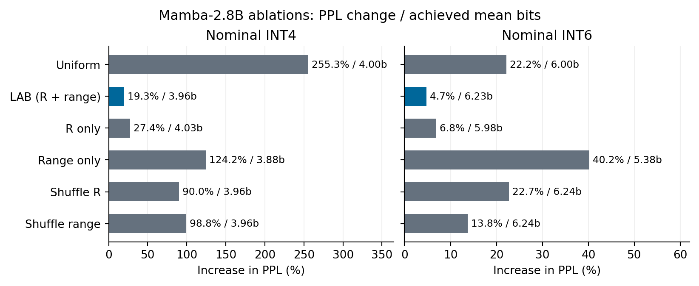

# Lyapunov-Aware Bit Allocation for State-Space Model Quantisation

Kentaro Sato · 2 November 2026 · [Paper (PDF)](LAB.pdf) · [Paper (Markdown)](LAB.md)

**If two values in a model’s memory are equally large, should they get the same number of bits?** A Mamba model carries a numerical state from one token to the next. A rounding error in one part of that state can fade by the next token. An error of the same size elsewhere can survive many updates and change a later prediction.

LAB uses a short calibration passage to estimate how long an error in each state group is likely to persist and how strongly that group influences the output. It combines those estimates with the range of values the group takes to assign its bit width. Across five Mamba-1 sizes, this rule kept the increase in perplexity below 4% on WikiText-2 at a nominal six bits. Giving every group six bits raised perplexity by at least 18% on each model.

## How does LAB decide where the bits go?

Each state update carries forward part of the previous error and adds the error introduced by the current rounding and clipping. LAB uses three measurements from a 1024-token calibration passage to decide which groups need finer precision. A group $g$ is a (channel, state-unit) pair in Mamba-1.

| Calibrated quantity | What it measures | Why it affects the bit allocation |
|---|---|---|
| Persistence $\rho_g$ | Mean magnitude of the state transition | A value closer to one suggests that an error will persist longer. |
| Output coupling $\Gamma_g$ | Mean squared coefficient that reads the state into the output | A larger coefficient gives a state error more influence on the readout. |
| Half-range $r_g = 7\,\mathrm{RMS}(h_g)$ | The range used to clip and quantise the state | A wider range makes rounding coarser at the same bit width. |

Here, $h_g$ denotes the state values in group $g$, and RMS (root mean square) measures their typical magnitude over the calibration passage.

LAB combines persistence and output coupling into an allocation score:

$$
R_g = \frac{\Gamma_g}{1-\rho_g}.
$$

In a fine-resolution noise approximation, a group's contribution to squared readout error scales as $R_g r_g^2 4^{-b_g}$. Minimising the sum of these contributions under a fixed total bit budget gives the continuous allocation:

$$
b_g^\star = c + \frac12\log_2 R_g + \log_2 r_g,
$$

where $c$ sets the total budget. **At the same range, a group with a fourfold score receives one extra bit in this formula; at the same score, a doubled range also calls for one extra bit.** This connects the dynamics of the state to the precision used to store it.

The implementation constructs integer extras from the score and range, centres them around the target budget, and rounds and limits the widths to 2–16 bits. The achieved mean can therefore differ from the target; the results below report both.

The motivating Lyapunov bound assumes a contraction bound at every step and zero-mean noise uncorrelated with the propagated error. LAB uses calibrated **mean** transition magnitudes as an empirical persistence estimate, while the continuous error model neglects clipping and cross-group error terms. The formula guides allocation under these approximations; its effect on prediction quality is evaluated in the experiments below. [Paper §3: theory, integer allocation, and calibration](LAB.md#3-theory-a-lyapunov-aware-bit-allocator).

## How much memory does that save?

We simulated rounding the recurrent state during inference and measured perplexity, a measure of how well the model predicts the next token. Lower is better. The table compares each model with its own FP16 baseline. Six bits was the **target average** for LAB, so the table also shows the width it actually used.

| Allocation on five Mamba-1 sizes | Actual mean bits | Estimated state-cache compression vs. FP16 | Measured perplexity increase |
|---|---:|---:|---:|
| Six bits for every group | 6.00 | 2.58× | +18.18% to +23.09% |
| LAB | 5.84–6.35 | 2.44–2.65× | **+3.35% to +3.98%** |

Both compression estimates include the cost of storing each group’s range and bit width, shared across 100 separately stored states. Repeatedly overwriting a single state counts as one stored state, regardless of how many tokens are processed. These estimates describe the recurrent state cache. End-to-end GPU memory and inference speed remain open engineering questions.

## Does it matter which groups get the bits?

In a separate test on five text windows, we kept each group’s range fixed and shuffled the joint score $R_g$ across groups. On Mamba-2.8B, LAB and the shuffled rule both averaged **3.96 bits**. Yet the perplexity increase rose from **19.3% to 90.0%** after shuffling. On these windows, the model kept more of its predictive quality when the score went to the group it described.

*Both panels report the separate five-window evaluation and use a different budget-adjustment procedure from the Mamba-2.8B rerun in the table above. The six-bit LAB penalty here is +4.7%.*

## How far does the result travel?

Across eight models, LAB gave the lowest perplexity of five allocation rules in **14 of 15** model–budget comparisons at nominal four- and six-bit budgets. These are descriptive rankings of the evaluated windows. Zamba2 was tested only at six bits, with quantisation at chunk boundaries; there, a simpler rule based on persistence narrowly led.

On Mamba-2.8B, LAB also gave lower perplexity than uniform allocation on two matched PG-19 windows at each length from 8K to 32K tokens. On a separate set of four windows at 32K, clipping the state to its calibrated range alone gave slightly lower perplexity than LAB. That comparison shows why clipping also matters when interpreting the long-context result.

The initial integer experiments tested a rule based on persistence and output influence alone. The reruns tested LAB’s revised weighting of that score together with each group’s range and retained the earlier rule for comparison. [Results by model and experiment](docs/RESULTS.md) · [Trace each figure and table to the data](docs/EVIDENCE_MAP.md)

[Experiment scripts](experiments/README.md) · [Saved results](results/README.md) · [License](LICENSE)
