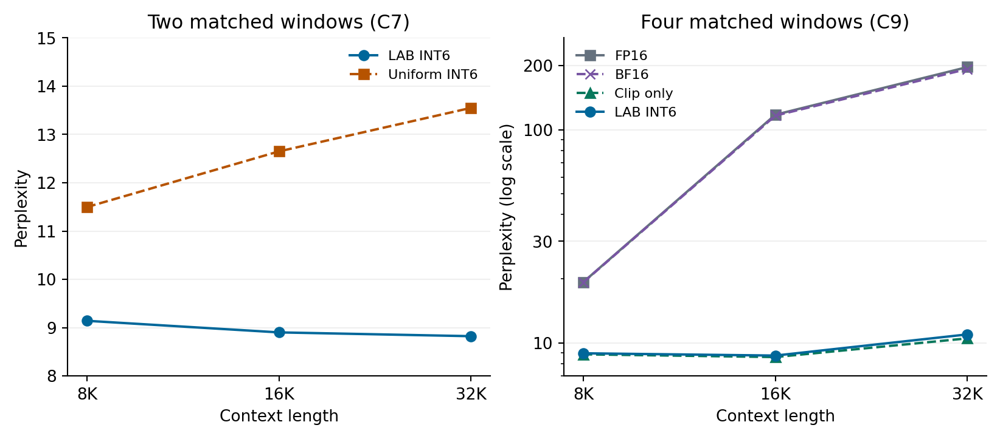

# Results by model and experiment

[Paper (PDF)](../LAB.pdf) · [Paper (Markdown)](../LAB.md) · [Figure and table evidence map](EVIDENCE_MAP.md)

## Which experiment does each number describe?

| Experiment | Reading the saved results |
|:---|:---|
| Initial integer transfer tests | `full` is the earlier slope-one, score-only allocator. Its C4 sweep reported 15/15 wins across three range multipliers. |
| Range-aware integer reruns | Read `full_A` for LAB in C4, C7, C8a/c/d, `profile_full_A` in C5b, and `FP16_full_A` in C9. The old `full` keys and their automatic verdicts are retained in the same files. The new C4 run demonstrates 5/5 wins at the one stored multiplier, k = 7. |
| Earlier factorisation (C16/C16b) | `half_slope_rg` already implements the range-aware formula. These five-window, targeted-mean measurements are a separate experiment from the one-shift deployment reruns. |
| Continuous noise (C3/C3b) | `full` specifies a noise amplitude proportional to the inverse square root of the score. Its fitted exponent is 1.94; it is not a measurement of an integer allocator. |

For example, the [anchor rerun](../results/phase_c4_state_int_quantisation_v2.json) records +6.69% at INT6 for the old `full` row and +3.98% for `full_A`. The 2.8B line in the [family summary](../results/phase_c8a_mamba_scale_sweep_v2.json) repeats the anchor; it does not represent an additional run. Calibration gave 0.987 correlation for log output coupling across WikiText-2 train and validation. The 77.5% bit-tier agreement pertains to the earlier score-only rule, not LAB.

## Quality and storage across five sizes

These are comparisons at **equal nominal budgets**. Actual LAB widths at INT6 span 5.84–6.35 bits. Both compression columns include the same assumed metadata: 20 bits per group amortised over 100 stored states, or 0.2 bits per unit. Compression is 16 divided by (mean bits + 0.2); PPL is measured by quantising and dequantising in the forward pass.

| Model | INT6 compression | INT6 ΔPPL | INT4 compression | INT4 ΔPPL |
|:---|---:|---:|---:|---:|
| 130M | 2.62× | +3.35% | 3.89× | +8.17% |
| 370M | 2.65× | +3.84% | 3.96× | +9.54% |
| 790M | 2.52× | +3.62% | 3.67× | +7.73% |
| 1.4B | 2.47× | +3.68% | 3.58× | +10.65% |
| 2.8B | 2.44× | +3.98% | 3.52× | +10.17% |

Without metadata, the corresponding INT4 estimates would be 3.68–4.17×. Neither set of ratios measures end-to-end GPU memory or kernel speed. At both nominal budgets, LAB lies on the quality–storage frontier for each of the five sizes (§6.4).

## What transfers to other models?

LAB had the lowest ΔPPL among the five compared integer methods on **seven models at both INT4 and INT6**: the five state-spaces sizes, Falcon-Mamba-7B, and Jamba. Falcon's INT6 penalty was +27.9%, versus +1.5% for Jamba. [Zamba2](../results/phase_c5b_ssm_quant_in_hybrid_v2.json) was tested only at INT6 with chunk-boundary injection: proxy_C2 was marginally better (−0.720%) than LAB (−0.692%), with uniform at −0.462%. Overall LAB ranked first in **14 of 15 model–budget cells**. The continuous experiment's complete ordering of the five methods held in **0 of 15** integer cells.

In the separate [Mamba-2.8B factorisation](../results/phase_c16b_lyapunov_vs_range_factorisation.json), nominal INT4 LAB reached +19.3% ΔPPL (3.96 achieved bits); assigning bits by range alone gave +124.2% (3.88 bits). Shuffling which units received either signal also raised PPL. At nominal INT6, the range-only row achieved just 5.38 bits beside LAB's 6.23; the shuffles at 6.24 bits provide closer comparisons.

## Long-context results: keep the windows paired

On the same **two PG-19 windows** at each length, uniform and LAB both have nominal INT6. These are absolute PPL values; the ratio is uniform divided by LAB.

| Context | LAB PPL | Uniform PPL | Uniform / LAB |
|:---|---:|---:|---:|
| 8K | 9.14 | 11.50 | 1.26× |
| 16K | 8.90 | 12.65 | 1.42× |
| 32K | 8.82 | 13.55 | 1.54× |

The [two-window C7 file](../results/phase_c7_long_context_validation%20_v2.json) contains both series. In a separate [four-window C9 ablation](../results/phase_c9_fp16_bf16_clip_ablation_v2.json), 32K PPL was **196.93** with FP16, **192.89** with BF16, **10.51** with clipping only, and **10.97** with LAB. That ablation has no uniform INT6 row. The two comparisons support different conclusions: LAB beats uniform on the paired C7 windows, and clipping alone is sufficient for low PPL on the C9 windows.

Earlier trajectories show range crossings in several layers. They summarise state magnitude, transition magnitude, and crossing frequency separately, so they do not establish which individual units caused the PPL change.

## Reproducing the tables and paper

[Experiment scripts](../experiments/README.md) · [Saved result files](../results/README.md) · [Verification script](../verification/verify_paper.py) · [Verification summary](../verification/summary.json)

From the repository root, run `make verify` with Python 3.9 or later to check the tables against the saved JSON. Run `make pdf` to typeset the paper with Pandoc, XeLaTeX, TeX Gyre Termes and Latin Modern Mono. The vector figures are included. To regenerate them from the saved measurements, run `make figures` with NumPy and Matplotlib installed. Set `PYTHON` to select a Python interpreter.

Kentaro Sato. *Lyapunov-Aware Bit Allocation for State-Space Model Quantisation*. 31 October 2026. [Contact](mailto:info@metaclan.jp) · [License](../LICENSE)
